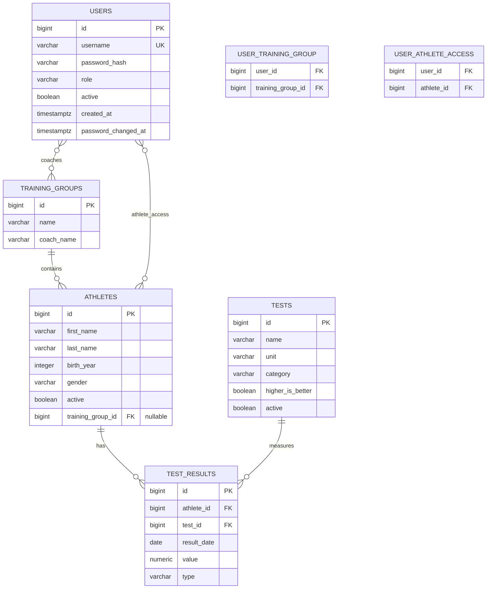

# TFHub – Data Model

**Status:** Initial version  
**Version:** 1.0  
**Project:** Track & Field Hub

## 1. Overview

This document describes the data model used by TFHub.

The application data model consists of athlete, test, result, user, and training-group entities:

- `Athlete` – an athlete managed by the coach.
- `Test` – a definition of an athletic performance test.
- `TestResult` – a recorded result of an athlete performing a test.
- `User` – login account, role, and active status.
- `TrainingGroup` – current athlete group and coach access scope.

There is no public registration or account-management UI. Administrators manage accounts through the authenticated backend API; training-group and athlete CRUD remain separate use cases.

## 2. Entity Relationship Diagram

## 3. Authentication Account

The `users` table stores application login accounts. `User` is distinct from `Athlete`; role belongs to the account.

| Field | Database type | Required | Description |
|---|---|---|---|
| id | BIGINT | Yes | Primary key, generated automatically |
| username | VARCHAR | Yes | Unique login name |
| password_hash | VARCHAR | Yes | Argon2id password hash; never a plaintext password |
| role | VARCHAR | Yes | `ADMIN`, `COACH`, or `ATHLETE` |
| active | BOOLEAN | Yes | Inactive accounts cannot authenticate or continue using an existing session |
| created_at | TIMESTAMP WITH TIME ZONE | Yes | Account creation time |
| password_changed_at | TIMESTAMP WITH TIME ZONE | Yes | Time the password was last changed |

The username must be unique case-insensitively after trimming leading and trailing whitespace; the application stores the trimmed username. Passwords are validated using the existing non-blank, maximum-1024-character rule and hashed with the configured Argon2id encoder. Account creation, editing, role-specific assignment, activation, deactivation, and administrator password reset are available through the ADMIN-only account-management API. Password hashes and plaintext passwords are never returned or logged.

The username's maximum length and case-normalization rules must be enforced consistently in the application and schema. The plaintext password must not be stored in PostgreSQL, configuration, environment variables, or logs.

## 3.1 TrainingGroup and memberships

`training_groups` contains an identity, required name, and optional descriptive `coach_name`. The descriptive field does not confer access. `user_training_group` is a many-to-many join for coaches and groups; each pair is unique. `user_athlete_access` is a many-to-many association between accounts and athletes, also with unique pairs. An ATHLETE account must have exactly one linked athlete in this release, and an athlete may be assigned to at most one ATHLETE account. The existing relationship schema is retained; account-management service validation and serialized transactional updates enforce role/membership compatibility and these cardinality rules.

Account-management writes acquire a PostgreSQL transaction-scoped advisory lock before validating assignments or changing account role/status. Under that lock, the service verifies that the committed result still contains at least one active ADMIN. This serializes competing administrator updates without changing the existing schema.

## 4. Athlete

Represents an athlete whose performance is tracked by the application.

### 4.1 Fields

| Field | Database type | Required | Description |
|---|---|---|---|
| id | BIGINT | Yes | Primary key, generated automatically |
| first_name | VARCHAR(100) | Yes | Athlete's first name |
| last_name | VARCHAR(100) | Yes | Athlete's last name |
| birth_year | INTEGER | Yes | Year of birth |
| gender | VARCHAR(20) | Yes | Athlete's gender |
| active | BOOLEAN | Yes | Indicates whether the athlete is active |
| training_group_id | BIGINT | No | Current group; null means unassigned |

### 4.2 Gender

Stored as a string in the database.

Allowed Java enum values:

- `MALE`
- `FEMALE`

### 4.3 Constraints

- Primary key: `id`.
- Unique constraint: `(first_name, last_name, birth_year)`.
- `active` defaults to `true`.
- `training_group_id` references `training_groups.id` with restrictive deletion. A coach-created athlete must have a group chosen from the authenticated coach's assigned groups; administrators may leave the group null or assign any existing group.

### 4.4 Business rules

- Athlete information can be edited.
- Athletes should not be physically deleted.
- An athlete can be deactivated by setting `active = false`.
- Deactivation must not delete or modify historical results.
- Inactive athletes remain available when viewing historical results.
- Inactive athletes should be excluded from active athlete lists by default.

Birth year is used instead of a full date of birth. Age-related statistics are based on the athlete's birth year.

## 5. Test

Represents a definition of an athletic performance test.

Examples:
- Standing long jump.
- 40-meter sprint.
- Medicine ball throw.

### 5.1 Fields

| Field | Database type | Required | Description |
|---|---|---|---|
| id | BIGINT | Yes | Primary key, generated automatically |
| name | VARCHAR(150) | Yes | Test name |
| unit | VARCHAR(10) | Yes | Canonical measurement unit |
| category | VARCHAR(30) | Yes | Test category |
| higher_is_better | BOOLEAN | Yes | Indicates whether a higher result is better |
| active | BOOLEAN | Yes | Indicates whether the test is active |

### 5.2 Categories

Stored as strings in the database.

Allowed Java enum values:

- `TIME`
- `DISTANCE`
- `SPEED`

Category describes the measurement type.

### 5.3 Units

Only the following canonical units are supported initially:

| Unit | Meaning |
|---|---|
| `s` | Seconds |
| `m` | Meters |
| `m/s` | Meters per second |

All results must be stored using the canonical unit defined by the test.

Examples:
- 40-meter sprint: seconds.
- Standing long jump: meters.
- Running speed: meters per second.

Time formatting is a frontend responsibility.

For example, a result of 2 minutes and 15 seconds is stored as `135.000` seconds, not as a formatted string.

### 5.4 Constraints

- Primary key: `id`.
- Test name must be unique case-insensitively after trimming leading and trailing whitespace, including inactive tests. PostgreSQL enforces this with a unique index on `lower(trim(name))`.
- `active` defaults to `true`.
- `higher_is_better` is defined individually for each test.

Examples:
- Sprint time: `higher_is_better = false`.
- Jump distance: `higher_is_better = true`.

### 5.5 Business rules

- Test definitions can be edited.
- Test names are unique across active and inactive tests, ignoring leading and trailing whitespace and letter casing.
- Tests with existing results must not be physically deleted.
- Such tests must be deactivated instead.
- Inactive tests must not be offered when recording new results by default.
- Historical results must remain accessible.

Changing a test's unit or category after results have been recorded requires special care because it may change the interpretation of historical data. Such changes should be prevented unless a deliberate data migration or correction is performed.

## 6. TestResult

Represents an individual result achieved by an athlete.

A result can originate from a training session or a competition.

### 6.1 Fields

| Field | Database type | Required | Description |
|---|---|---|---|
| id | BIGINT | Yes | Primary key, generated automatically |
| athlete_id | BIGINT | Yes | Reference to the athlete |
| test_id | BIGINT | Yes | Reference to the test |
| result_date | DATE | Yes | Date when the result was achieved |
| value | NUMERIC(12,3) | Yes | Numeric result in the test's canonical unit |
| type | VARCHAR(30) | Yes | Result origin |

### 6.2 Result types

Stored as strings in the database.

Allowed Java enum values:

- `TRAINING`
- `COMPETITION`

`TRAINING` represents a result recorded during training.

`COMPETITION` represents a result achieved during a competition.

No separate Competition entity is required initially.

### 6.3 Constraints

- Primary key: `id`.
- Foreign key: `athlete_id` references `athletes.id`.
- Foreign key: `test_id` references `tests.id`.
- `value` must be greater than zero.
- `result_date` stores a calendar date without time or timezone.

### 6.4 Business rules

- Results can be created, edited and deleted.
- Results must reference an existing athlete and test.
- Results must use the canonical unit of the selected test.
- Results must be positive numbers.
- New results can be recorded only for active athletes. Existing historical results for deactivated athletes remain accessible.
- New results can be recorded only for active tests. An existing result may retain its current inactive test during editing, but it cannot be changed to a different inactive test.
- Multiple results for the same athlete, test and date are technically allowed.
- The application does not enforce uniqueness of `(athlete_id, test_id, result_date)`.

## 7. Relationships

### 7.1 Athlete – TestResult

One athlete can have multiple test results.

Each test result belongs to exactly one athlete.

Deleting an athlete with existing results must be prevented.

### 7.2 Test – TestResult

One test can have multiple results.

Each test result belongs to exactly one test.

Deleting a test with existing results must be prevented.

### 7.3 Referential integrity

Foreign key constraints are enforced by PostgreSQL.

The database uses `ON DELETE RESTRICT` for both relationships.

An athlete has zero or one current training group. A coach may belong to multiple groups and a group may have multiple coaches. Reassignment changes current coach access only; it does not update, delete, or re-parent historical results.

## 8. Data Types and Precision

### 8.1 Numeric values

Test results use `NUMERIC(12,3)`.

This provides:
- Up to 12 total digits.
- Up to 3 decimal places.

Examples:
- `12.340`
- `135.000`
- `8.750`

The application must not store formatted values such as `2:15.00`.

### 8.2 Dates

Results use PostgreSQL `DATE`.

The corresponding Java type should be `LocalDate`.

No time or timezone information is stored.

### 8.3 Enumerations

Enum-like values are stored as VARCHAR columns.

Java enums provide application-level type safety.

Database columns are not PostgreSQL native enum types.

## 9. Database Schema Management

The current athlete, test, and result schema is created by Flyway migration:

`V1__create_initial_schema.sql`

The migration creates:

- `athletes`
- `tests`
- `test_results`

The authentication and training-group tables were introduced through `V3__add_users_and_training_groups.sql`; the migration adds a nullable athlete group reference and preserves existing athlete and result rows. UC-402 reuses these tables and adds no schema migration. Do not alter an already-applied migration. All future database modifications must be introduced through new Flyway migrations.

Existing applied migrations must not be modified.

Hibernate uses schema validation and must not modify the schema automatically.

## 10. Explicitly Excluded Entities and Capabilities

The following entities and capabilities are not part of the current model:

- Public registration or account-management UI
- Training-group management UI and athlete group-reassignment UI
- TrainingSession
- Competition
- TrainingPlan

They may be introduced later when supported by actual application requirements.

## 11. Future Extensions

Potential future improvements include:

- Administrative user/group management screens.
- Parent accounts and multiple athlete profiles per account.
- Detailed competition metadata.
- Import of external competition results.
- Training sessions.
- Performance history and analytics.
- Additional measurement units and test categories.

These extensions must not be implemented without an explicit requirement and corresponding model update.

---

**End of document**