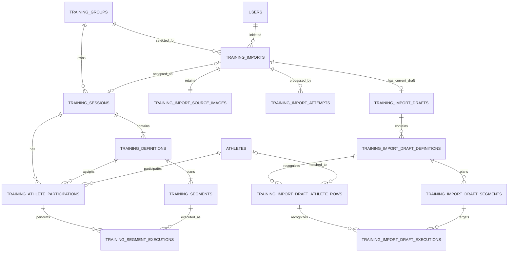

# TFHub Training Module — Data Model Design

**Status:** Agreed design decisions
**Scope:** Running training sessions, named variants, segment execution, printable sheets, and reviewed OCR imports.

## 1. Design decisions

- A `Training` is one dated session for exactly one existing `TrainingGroup`.
- The training group is immutable after creation.
- A `TrainingDefinition` is a named, ordered variant within one training. It is not a reusable template.
- Athletes participate in one definition per training.
- Historical participation and executions remain valid after the athlete's current group changes.
- Training executions are separate from `test_results`. Reuse its numeric representation, not its entity or business semantics.
- Imports and OCR drafts are separate from persisted training data. Only explicit acceptance creates a training and related records.
- Training groups have no active/inactive lifecycle. Do not add a group lifecycle field.
- Do not add a generic exercise abstraction, sheet snapshot tables, draft revision history, audit log, or event-sourcing mechanism.

The existing application uses PostgreSQL, Spring Data JPA, Flyway, identity `BIGINT` primary keys, plural snake_case tables, string-valued enums, and restrictive foreign keys for historical records. Add schema through a new Flyway migration; do not modify an existing migration.

## 2. Persisted training data

### 2.1 `training_sessions`

One persisted training event for one group.

| Column | Type | Null | Meaning |
|---|---|---:|---|
| `id` | `BIGINT` identity | No | Primary key |
| `training_group_id` | `BIGINT` | No | FK to `training_groups.id` |
| `name` | `VARCHAR` | No | Training name |
| `training_date` | `DATE` | No | Calendar date |
| `status` | `VARCHAR(20)` | No | `PLANNED` or `COMPLETED`; defaults to `PLANNED` |

Use `ON DELETE RESTRICT` / `ON UPDATE RESTRICT` for the group FK. Constrain status to `PLANNED` or `COMPLETED`. Do not add creator-based access. Group immutability is an application invariant: creation sets the group, and no create/edit/import operation may subsequently change it. No trigger is proposed.

### 2.2 `training_definitions`

One named variant within a training.

| Column | Type | Null | Meaning |
|---|---|---:|---|
| `id` | `BIGINT` identity | No | Primary key |
| `training_session_id` | `BIGINT` | No | FK to `training_sessions.id` |
| `name` | `VARCHAR` | No | Variant name |
| `sequence_number` | `INTEGER` | No | Display order |

Definitions have a unique `(training_session_id, sequence_number)` order. Also enforce `UNIQUE (id, training_session_id)` for the participation composite FK. Names must not be blank.

### 2.3 `training_segments`

One planned segment within a definition.

| Column | Type | Null | Meaning |
|---|---|---:|---|
| `id` | `BIGINT` identity | No | Stable segment identity |
| `training_definition_id` | `BIGINT` | No | FK to `training_definitions.id` |
| `sequence_number` | `INTEGER` | No | Order within the definition |
| `distance_m` | `INTEGER` | No | Planned distance in metres |
| `rest_after_seconds` | `INTEGER` | Yes | Optional rest after segment |

Enforce unique `(training_definition_id, sequence_number)`, positive sequence and distance, and nonnegative rest when present. Segment identity is its `id`, not its sequence; reordering updates sequence only. Enforce `UNIQUE (id, training_definition_id)` for execution integrity.

### 2.4 `training_athlete_participations`

One athlete's assignment to one definition in one training.

| Column | Type | Null | Meaning |
|---|---|---:|---|
| `id` | `BIGINT` identity | No | Primary key |
| `training_session_id` | `BIGINT` | No | FK to the training |
| `training_definition_id` | `BIGINT` | No | Definition within that training |
| `athlete_id` | `BIGINT` | No | FK to `athletes.id` |

Enforce `UNIQUE (training_session_id, athlete_id)` so an athlete cannot be assigned to two definitions in one training. Enforce `FOREIGN KEY (training_definition_id, training_session_id)` to `training_definitions(id, training_session_id)`. Also enforce `UNIQUE (id, training_definition_id)` for execution integrity.

At initial assignment, validate that the athlete currently belongs to the training's group and has a group. Do not store or FK the athlete's current group in this participation: reassignment later must not invalidate historical participation. Existing assignments are not revalidated during unrelated edits.

### 2.5 `training_segment_executions`

Execution data for one participant and one planned segment.

| Column | Type | Null | Meaning |
|---|---|---:|---|
| `id` | `BIGINT` identity | No | Primary key |
| `participation_id` | `BIGINT` | No | Athlete participation |
| `training_segment_id` | `BIGINT` | No | Planned segment executed |
| `training_definition_id` | `BIGINT` | No | Shared definition key for composite FKs |
| `status` | `VARCHAR` | No | Execution state |
| `measured_result` | `NUMERIC(12,3)` | Yes | Running time in seconds |
| `uses_spikes` | `BOOLEAN` | No | Defaults to `FALSE` |

Create one execution per participation/segment pair, initially `PENDING`, so missing information is distinct from completion. Allowed states: `PENDING`, `RECORDED`, `COMPLETED_WITHOUT_RESULT`, `NOT_COMPLETED`. A result is required only for `RECORDED`; otherwise it is null. A spike value is independent of status; OCR uncertainty is not stored here.

Enforce:

- `UNIQUE (participation_id, training_segment_id)`.
- `FOREIGN KEY (participation_id, training_definition_id)` to `training_athlete_participations(id, training_definition_id)`.
- `FOREIGN KEY (training_segment_id, training_definition_id)` to `training_segments(id, training_definition_id)`.
- Result `>= 0`; `RECORDED` iff result is non-null; status restricted to the allowed values.

### 2.6 Result representation

The existing `TestResult` uses Java `BigDecimal`, JPA precision 12/scale 3, PostgreSQL `NUMERIC(12,3)`, and request validation allowing 9 integer and 3 fractional digits. `test_results` also checks `value > 0`.

Use the same numeric representation for training, but do not reuse `TestResult`, its `> 0` rule, or its `ResultType`. Training UCs allow nonnegative results, so training checks `measured_result >= 0`. The initial design assumes running time in seconds; the UCs should explicitly state the unit.

## 3. Import and draft data

Import/draft rows are not ordinary persisted training records. One required `training_group_id` is selected at upload and is immutable throughout processing, review, and finalization. Do not keep a second editable group field.

### 3.1 `training_imports`

One upload and its workflow state.

| Column | Type | Null | Meaning |
|---|---|---:|---|
| `id` | `BIGINT` identity | No | Primary key |
| `training_group_id` | `BIGINT` | No | Immutable FK to `training_groups.id` |
| `initiated_by_user_id` | `BIGINT` | No | FK to `users.id` |
| `status` | `VARCHAR` | No | Import lifecycle state |
| `created_at` | `TIMESTAMPTZ` | No | Upload time |
| `possible_duplicate` | `BOOLEAN` | No | Duplicate warning; defaults to `FALSE` |
| `accepted_training_session_id` | `BIGINT` | Yes | Unique FK to `training_sessions.id`; set on acceptance only |

Restrict deletion of referenced users, groups, and accepted sessions. Accepted session ID must be set exactly when status is `ACCEPTED`.

When a training session is permanently deleted under UC-505, delete its linked accepted import and all import-owned database rows first; remove the optimized image after commit.

### 3.2 `training_import_source_images`

One immutable optimized image per import, stored on persistent filesystem storage rather than in PostgreSQL.

| Column | Type | Null | Meaning |
|---|---|---:|---|
| `import_id` | `BIGINT` | No | PK and FK to `training_imports.id` |
| `storage_key` | `VARCHAR` | No | Unique internal storage key |
| `media_type` | `VARCHAR` | No | Stored type, initially JPEG |
| `original_filename` | `VARCHAR(255)` | No | Sanitized client filename metadata; never used as a path |
| `byte_size` | `BIGINT` | No | Stored file size |
| `width` | `INTEGER` | No | Stored image width |
| `height` | `INTEGER` | No | Stored image height |
| `sha256` | `VARCHAR(64)` | No | Hash of stored image |

Index `sha256` non-uniquely to detect exact duplicates. Do not make it unique: duplicate uploads must create separate imports. Do not expose storage keys through the API.

### 3.3 `training_import_attempts`

Processing history for one import. Keep failed attempts; retry does not create another import.

| Column | Type | Null | Meaning |
|---|---|---:|---|
| `id` | `BIGINT` identity | No | Primary key |
| `import_id` | `BIGINT` | No | FK to import |
| `attempt_number` | `INTEGER` | No | Sequential per import |
| `requested_by_user_id` | `BIGINT` | Yes | FK to user for explicit processing/retry; null for worker |
| `model_name` | `VARCHAR` | No | Initially Gemini Flash-Lite 3.5 |
| `status` | `VARCHAR` | No | `PROCESSING`, `SUCCEEDED`, or `FAILED` |
| `started_at` | `TIMESTAMPTZ` | No | Attempt start |
| `finished_at` | `TIMESTAMPTZ` | Yes | Attempt completion |
| `raw_model_response` | `TEXT` | Yes | Exact response body, when returned by the model |
| `failure_code` | `VARCHAR` | Yes | Safe diagnostic category |
| `failure_message` | `TEXT` | Yes | Safe diagnostic detail |

Enforce unique `(import_id, attempt_number)`, positive attempt number, and at most one processing attempt per import with a partial unique index on `import_id WHERE status = 'PROCESSING'`. Store the raw response for troubleshooting, including invalid responses; it is nullable when no response was received. Keep it server-side only and out of API responses. Logs exclude it by default; the explicitly enabled Gemini diagnostic mode described below is an exception. Protect stored responses as athlete-related data. Never store credentials.

### 3.4 `training_import_drafts`

The single current editable draft per import.

| Column | Type | Null | Meaning |
|---|---|---:|---|
| `id` | `BIGINT` identity | No | Primary key |
| `import_id` | `BIGINT` | No | Unique FK to import |
| `generated_by_attempt_id` | `BIGINT` | No | FK to successful attempt |
| `name` | `VARCHAR` | No | Correctable training name |
| `training_date` | `DATE` | No | Correctable date |
| `recognition_metadata` | `JSONB` | No | OCR confidence/uncertainty metadata |

No draft revision, rollback, or snapshot table is used.

### 3.5 `training_import_draft_definitions`

| Column | Type | Null | Meaning |
|---|---|---:|---|
| `id` | `BIGINT` identity | No | Primary key |
| `draft_id` | `BIGINT` | No | Parent draft |
| `name` | `VARCHAR` | No | Corrected definition name |
| `sequence_number` | `INTEGER` | No | Definition order |

Enforce unique `(draft_id, sequence_number)` and `(id, draft_id)`. Name must not be blank.

### 3.6 `training_import_draft_segments`

| Column | Type | Null | Meaning |
|---|---|---:|---|
| `id` | `BIGINT` identity | No | Primary key |
| `draft_id` | `BIGINT` | No | Parent draft |
| `definition_id` | `BIGINT` | No | Parent draft definition |
| `sequence_number` | `INTEGER` | No | Segment order |
| `distance_m` | `INTEGER` | Yes | Corrected distance; null means OCR could not resolve it |
| `rest_after_seconds` | `INTEGER` | Yes | Optional rest |
| `recognition_metadata` | `JSONB` | No | Recognition details |

Enforce `UNIQUE (id, draft_id, definition_id)` and `FOREIGN KEY (definition_id, draft_id)` to `training_import_draft_definitions(id, draft_id)`. Sequence must be positive; distance must be positive when present; rest must be nonnegative when present. Migration V11 permits null only on draft segments. Unresolved distances require review and block acceptance; final training segments remain non-null and positive.

### 3.7 `training_import_draft_athlete_rows`

| Column | Type | Null | Meaning |
|---|---|---:|---|
| `id` | `BIGINT` identity | No | Primary key |
| `draft_id` | `BIGINT` | No | Parent draft |
| `definition_id` | `BIGINT` | No | Variant containing this row |
| `athlete_id` | `BIGINT` | Yes | FK to matched existing athlete |
| `recognized_name` | `TEXT` | No | Original recognized identity text |
| `match_status` | `VARCHAR` | No | `UNRESOLVED`, `MATCHED`, or `SKIPPED` |
| `recognition_metadata` | `JSONB` | No | Recognition/match confidence and uncertainty |

Enforce `UNIQUE (id, draft_id, definition_id)` and composite FK `(definition_id, draft_id)` to the draft definition. Check that `MATCHED` has an athlete ID and other states do not. A partial unique index on `(draft_id, athlete_id) WHERE match_status = 'MATCHED' AND athlete_id IS NOT NULL` prevents matching the same athlete to multiple rows/definitions in one import.

### 3.8 `training_import_draft_executions`

| Column | Type | Null | Meaning |
|---|---|---:|---|
| `id` | `BIGINT` identity | No | Primary key |
| `draft_id` | `BIGINT` | No | Parent draft |
| `definition_id` | `BIGINT` | No | Shared parent definition |
| `athlete_row_id` | `BIGINT` | No | Recognized athlete row |
| `segment_id` | `BIGINT` | No | Planned draft segment |
| `status` | `VARCHAR` | No | Correctable execution state |
| `measured_result` | `NUMERIC(12,3)` | Yes | Corrected result |
| `uses_spikes` | `BOOLEAN` | Yes | Nullable until recognized/corrected |
| `recognized_text` | `TEXT` | Yes | Original cell text |
| `recognition_metadata` | `JSONB` | No | Confidence/uncertainty |

Enforce unique `(athlete_row_id, segment_id)`, FKs `(athlete_row_id, draft_id, definition_id)` to draft athlete rows and `(segment_id, draft_id, definition_id)` to draft segments. This prevents cross-draft and cross-definition references. Use the same execution status/result checks as persisted executions; draft spike uncertainty remains here and is converted to the required final boolean on acceptance.

## 4. Relationships and database integrity

Use restrictive deletes for training data and import data. Never cascade-delete recorded training data. Child foreign keys and composite-key indexes support detail retrieval. Index training sessions by `(training_group_id, status, training_date DESC, id)` and imports by `(training_group_id, status, created_at)`.

Validate current coach membership, athlete group membership on initial assignment/acceptance, immutable group values, and UC edit rules in transactional services. Do not use the athlete's current group to filter historical participation. At least one definition per training and at least one segment per definition are aggregate rules validated by create/edit/review/accept operations, not triggers.

## 5. Historical edit behavior

Follow UC-503 using the current persisted state only:

- A definition with currently recorded execution cannot be removed.
- A segment with currently recorded execution cannot be removed or have its distance changed.
- A participation with currently recorded execution cannot be removed.
- Unrecorded executions may be removed with their segment, definition, or participation as permitted by the UCs.
- Recorded execution values can be corrected; changing status away from `RECORDED` clears the result.
- Rest and sequence order may change despite recorded data.

Do not track whether a value was recorded in the past or add audit/history mechanisms.

## 5.1 Separate plan editing from training completion

The persisted schema continues to support both workflows without a migration:

- UC-502 creates only the training session, definitions, and segments. It does not create athlete participations or execution rows.
- UC-503 edits only the training name/date and definition/segment plan. Retained participation and execution rows are not supplied by the request and are not rewritten. Adding a segment initializes a `PENDING` execution for each currently assigned participant in that definition. Removing a definition or segment is allowed only when it has no `RECORDED` executions; the operation removes its dependent participations/executions as applicable.
- UC-510 manages participation and execution values using explicit add/update/remove operations. Omitted participants/executions are unchanged, avoiding accidental removal by a stale form. A move is an explicit removal plus addition and is prohibited when the participant has a `RECORDED` execution.
- Normal create/edit-plan and completion flows use separate API endpoints and frontend tasks. UC-509 acceptance remains an explicitly atomic import path that creates a complete reviewed training, including participants and executions.

No ownership, snapshot, audit, revision, or new lifecycle tables are needed for this separation.

## 6. Image storage

Store one image per import on a persistent filesystem volume, not in PostgreSQL. Convert to JPEG at approximately 85% quality and resize oversized images to a maximum 2560-pixel long edge without upscaling. Keep only this optimized JPEG; do not retain the uploaded bytes separately. Validate the settings with representative handwritten sheets to ensure OCR quality is not noticeably degraded.

The database stores only the generated internal `storage_key` and metadata; do not expose storage paths in API responses. Coordinate file and database persistence: write to a temporary file, validate and optimize it, then atomically move it to a generated storage key. Remove the stored file if import persistence fails and clean up unreferenced generated files and stale temporary files on application startup if the process fails between file placement and database commit.

For production Compose, mount a dedicated named volume such as `tfhub-prod-training-import-images` at `/var/lib/tfhub/training-imports` in the API container only, writable by the existing non-root API user. Do not use the API's `/tmp` tmpfs for retained images. Back up the image volume with the database backup set and test a coordinated restoration; existing XLSX/database backups do not contain image files. No automatic import/image deletion is introduced, so enforce upload limits and monitor available disk space.

The initial UC-506 limits are a 15 MiB upload, 8,000 pixels per input dimension, and 24 million input pixels; JPEG and PNG are accepted and converted to JPEG at quality 85. These limits are configurable through the `TFHUB_TRAINING_IMPORT_*` environment variables and should be adjusted only after checking memory and disk capacity on the Raspberry Pi.

## 7. Paper sheet and OCR

A sheet may contain one training header and multiple definition sections; each section contains its ordered segments and assigned athlete rows. Because one training has one group, group text is not needed to disambiguate participants from different groups.

A generated sheet snapshot table is not required by UC-501 through UC-509. OCR maps recognized rows against the selected group and the draft structure. Add print-time snapshots only if a later approved requirement needs exact mapping to assignments as they existed when a sheet was printed.

UC-507 requires Gemini Flash-Lite 3.5 and exactly one model call per processing attempt. OCR produces a structured draft with recognized text and uncertainty metadata. The user manually reviews and explicitly accepts or rejects the whole draft. No accepted training entities are created during upload, processing, or review.

## 8. Import lifecycle, retry, and acceptance

Import states: `PENDING → PROCESSING → REVIEW_REQUIRED`; processing failure gives `FAILED`; retry is allowed from `FAILED`; only `REVIEW_REQUIRED` can become `ACCEPTED` or `REJECTED`. Final states cannot be reopened.

Use a bounded in-process worker that polls pending imports; no external queue is required for the single-instance deployment. Claim processing using a conditional status update or row lock and create an attempt in the same short transaction. Permit only one attempt with `PROCESSING` status per import, enforced by the partial unique index. Run the single model call outside the transaction. On restart or timeout, mark stale attempts failed so the import can be explicitly retried.

Validate new OCR output before atomically replacing the current draft and setting `REVIEW_REQUIRED`. A failed attempt records its failure and leaves any existing valid draft untouched. Retry uses the same optimized source image and creates no second import. Keep recovery simple: a stale processing attempt is marked failed so the import can be explicitly retried; timeout is operational configuration.

Acceptance locks the import, then revalidates the draft, current coach-group authorization, and each matched athlete's current group. In one transaction:

1. Create one `training_session` with status `PLANNED`, using the immutable import group.
2. Create definitions, segments, matched participations, and executions.
3. Omit skipped rows from persisted training data.
4. Set the import's accepted-session link and `ACCEPTED` status.

Any failure rolls back the session and all children and leaves the import unaccepted. Rejection changes status only and retains the optimized image, current draft, and processing attempts. Keep one current draft per import; do not add draft revisions, a review-edit audit log, or a separate review-history model.

## 9. Implementation alignment

- The upload-selected group is immutable through processing, review, retry, and finalization. Athlete candidates and assignments are restricted to that group.
- The retained source is the optimized JPEG. The original upload bytes are not retained.
- Processing attempts retain the raw model response when one is returned; the response is not exposed to clients and is excluded from logs unless Gemini diagnostic logging is explicitly enabled.
- Each import has one current editable draft and its processing-attempt records. User edits do not create draft versions or an audit trail.
- Acceptance creates a `PLANNED` training session. The persisted training lifecycle uses `PLANNED` and `COMPLETED`, not the legacy `active` flag.
- Existing training groups have no lifecycle field; selecting an existing group does not include an active/inactive check.
- Plan editing and participation/execution completion remain separate operations; import acceptance is the explicit atomic path that creates both.
- Training measured results use seconds, `NUMERIC(12,3)`, and the nonnegative rule; they do not reuse the positive-only test-result rule.

## 10. Remaining decisions

The confirmed JPEG settings are quality 85 and a 2560-pixel maximum long edge. OCR quality validation remains an implementation check. The stale-processing and Gemini request timeouts, worker concurrency, and upload limits are operational configuration. Supply `GEMINI_API_KEY` only to the API at runtime; do not put it in the frontend, database, image, or logs. Resolve the provider API model identifier for the approved Gemini Flash-Lite 3.5 model during configuration.

For temporary troubleshooting, `TFHUB_GEMINI_DIAGNOSTIC_LOGGING_ENABLED=true` enables INFO logs of the full JSON request body, including the prompt and base64-encoded optimized photo, and the full response body and HTTP status, including provider errors. A diagnostic ID correlates each request and response. The default is `false`; request authentication headers are not logged and occurrences of the configured API key in logged bodies are redacted. These logs can contain athlete data and large images: enable only in a controlled environment, restrict access and retention of every log destination, and turn it off after troubleshooting. A network failure has no response body to log.
