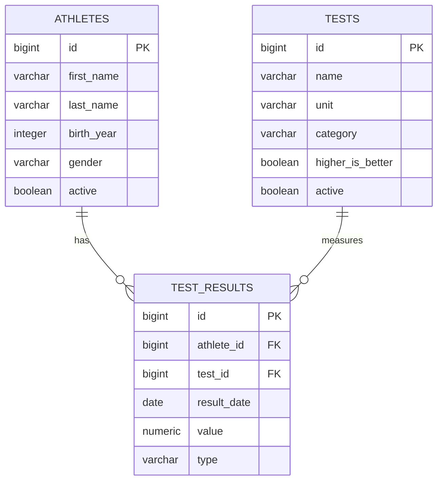

# TFHub – Data Model

**Status:** Initial version  
**Version:** 1.0  
**Project:** Track & Field Hub

## 1. Overview

This document describes the data model used by TFHub.

The initial database consists of three main entities:

- `Athlete` – an athlete managed by the coach.
- `Test` – a definition of an athletic performance test.
- `TestResult` – a recorded result of an athlete performing a test.

The model is designed for a single coach. Multi-user support is outside the current scope.

## 2. Entity Relationship Diagram

## 3. Athlete

Represents an athlete whose performance is tracked by the application.

### 3.1 Fields

| Field | Database type | Required | Description |
|---|---|---|---|
| id | BIGINT | Yes | Primary key, generated automatically |
| first_name | VARCHAR(100) | Yes | Athlete's first name |
| last_name | VARCHAR(100) | Yes | Athlete's last name |
| birth_year | INTEGER | Yes | Year of birth |
| gender | VARCHAR(20) | Yes | Athlete's gender |
| active | BOOLEAN | Yes | Indicates whether the athlete is active |

### 3.2 Gender

Stored as a string in the database.

Allowed Java enum values:

- `MALE`
- `FEMALE`

### 3.3 Constraints

- Primary key: `id`.
- Unique constraint: `(first_name, last_name, birth_year)`.
- `active` defaults to `true`.

### 3.4 Business rules

- Athlete information can be edited.
- Athletes should not be physically deleted.
- An athlete can be deactivated by setting `active = false`.
- Deactivation must not delete or modify historical results.
- Inactive athletes remain available when viewing historical results.
- Inactive athletes should be excluded from active athlete lists by default.

Birth year is used instead of a full date of birth. Age-related statistics are based on the athlete's birth year.

## 4. Test

Represents a definition of an athletic performance test.

Examples:
- Standing long jump.
- 40-meter sprint.
- Medicine ball throw.

### 4.1 Fields

| Field | Database type | Required | Description |
|---|---|---|---|
| id | BIGINT | Yes | Primary key, generated automatically |
| name | VARCHAR(150) | Yes | Test name |
| unit | VARCHAR(10) | Yes | Canonical measurement unit |
| category | VARCHAR(30) | Yes | Test category |
| higher_is_better | BOOLEAN | Yes | Indicates whether a higher result is better |
| active | BOOLEAN | Yes | Indicates whether the test is active |

### 4.2 Categories

Stored as strings in the database.

Allowed Java enum values:

- `TIME`
- `DISTANCE`
- `SPEED`

Category describes the measurement type.

### 4.3 Units

Only the following canonical units are supported initially:

| Unit | Meaning |
|---|---|
| `s` | Seconds |
| `m` | Meters |
| `m/s` | Meters per second |

All results must be stored using the canonical unit defined by the test.

Examples:
- 40-meter sprint: seconds.
- Standing long jump: meters.
- Running speed: meters per second.

Time formatting is a frontend responsibility.

For example, a result of 2 minutes and 15 seconds is stored as `135.000` seconds, not as a formatted string.

### 4.4 Constraints

- Primary key: `id`.
- `active` defaults to `true`.
- `higher_is_better` is defined individually for each test.

Examples:
- Sprint time: `higher_is_better = false`.
- Jump distance: `higher_is_better = true`.

### 4.5 Business rules

- Test definitions can be edited.
- Tests with existing results must not be physically deleted.
- Such tests must be deactivated instead.
- Inactive tests must not be offered when recording new results by default.
- Historical results must remain accessible.

Changing a test's unit or category after results have been recorded requires special care because it may change the interpretation of historical data. Such changes should be prevented unless a deliberate data migration or correction is performed.

## 5. TestResult

Represents an individual result achieved by an athlete.

A result can originate from a training session or a competition.

### 5.1 Fields

| Field | Database type | Required | Description |
|---|---|---|---|
| id | BIGINT | Yes | Primary key, generated automatically |
| athlete_id | BIGINT | Yes | Reference to the athlete |
| test_id | BIGINT | Yes | Reference to the test |
| result_date | DATE | Yes | Date when the result was achieved |
| value | NUMERIC(12,3) | Yes | Numeric result in the test's canonical unit |
| type | VARCHAR(30) | Yes | Result origin |

### 5.2 Result types

Stored as strings in the database.

Allowed Java enum values:

- `TRAINING`
- `COMPETITION`

`TRAINING` represents a result recorded during training.

`COMPETITION` represents a result achieved during a competition.

No separate Competition entity is required initially.

### 5.3 Constraints

- Primary key: `id`.
- Foreign key: `athlete_id` references `athletes.id`.
- Foreign key: `test_id` references `tests.id`.
- `value` must be greater than zero.
- `result_date` stores a calendar date without time or timezone.

### 5.4 Business rules

- Results can be created, edited and deleted.
- Results must reference an existing athlete and test.
- Results must use the canonical unit of the selected test.
- Results must be positive numbers.
- Results can be recorded for inactive athletes when historical data needs to be supplemented.
- New results should normally be recorded only for active tests.
- Multiple results for the same athlete, test and date are technically allowed.
- The application does not enforce uniqueness of `(athlete_id, test_id, result_date)`.

## 6. Relationships

### 6.1 Athlete – TestResult

One athlete can have multiple test results.

Each test result belongs to exactly one athlete.

Deleting an athlete with existing results must be prevented.

### 6.2 Test – TestResult

One test can have multiple results.

Each test result belongs to exactly one test.

Deleting a test with existing results must be prevented.

### 6.3 Referential integrity

Foreign key constraints are enforced by PostgreSQL.

The database uses `ON DELETE RESTRICT` for both relationships.

## 7. Data Types and Precision

### 7.1 Numeric values

Test results use `NUMERIC(12,3)`.

This provides:
- Up to 12 total digits.
- Up to 3 decimal places.

Examples:
- `12.340`
- `135.000`
- `8.750`

The application must not store formatted values such as `2:15.00`.

### 7.2 Dates

Results use PostgreSQL `DATE`.

The corresponding Java type should be `LocalDate`.

No time or timezone information is stored.

### 7.3 Enumerations

Enum-like values are stored as VARCHAR columns.

Java enums provide application-level type safety.

Database columns are not PostgreSQL native enum types.

## 8. Database Schema Management

The initial database schema is created by Flyway migration:

`V1__create_initial_schema.sql`

The migration creates:

- `athletes`
- `tests`
- `test_results`

All future database modifications must be introduced through new Flyway migrations.

Existing applied migrations must not be modified.

Hibernate uses schema validation and must not modify the schema automatically.

## 9. Explicitly Excluded Entities

The following entities are not part of the initial model:

- User
- TrainingGroup
- TrainingSession
- Competition
- TrainingPlan

They may be introduced later when supported by actual application requirements.

## 10. Future Extensions

Potential future improvements include:

- Athlete groups.
- Multiple coaches and user ownership.
- Detailed competition metadata.
- Import of external competition results.
- Training sessions.
- Performance history and analytics.
- Additional measurement units and test categories.

These extensions must not be implemented without an explicit requirement and corresponding model update.

---

**End of document**